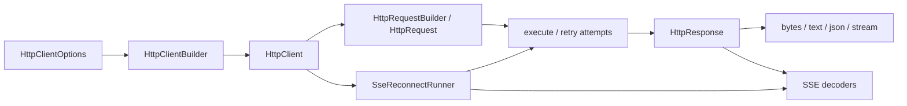

# qubit-http Design

[中文设计文档](design.zh_CN.md) | [User Guide](user_guide.en.md) | [README](../README.md)

This document describes the execution boundaries of `qubit-http` 0.16.0. The source code and tests define the behavior; this document records the choices that callers and maintainers need to preserve.

## Components and ownership

`HttpClientBuilder` validates `HttpClientOptions` and creates the underlying `reqwest::Client`. A client owns the connection pool, default policy, injectors, interceptors, and a redaction snapshot. `HttpRequestBuilder` captures the base URL, origin policy, default headers, injectors, and redaction context into an `HttpRequest`; a send does not borrow mutable client configuration. The executing client supplies the backend, logging options, request/response interceptors, and outer retry policy, while the request's captured redactor is the single policy for request/response logs, execution errors, later response reads, and SSE diagnostics. Executing a request built by client A on client B does not merge or replace A's redaction snapshot. Rebuilding a client does not rebind old requests; callers needing a new redaction policy build a new request from the rebuilt client. Initial URL resolution and origin checks use the request snapshot. Redirect checks use the executing client's reqwest redirect policy and the original request origin. Independently constructed `HttpLogger` values continue to use their explicitly supplied policy.

`HttpClient::rebuild_with_options` constructs a new backend and redaction snapshot while cloning the client's registered header injectors and request/response interceptors. It leaves the original client untouched, including on validation failure. `to_builder` copies options only. Callers that rebuild a configured client must choose the preserving API when runtime hooks are part of their contract.

The default `SameOrigin` policy checks absolute request targets against a configured base URL and checks each redirect against the initial origin. A client without a base URL may start at an absolute URL, which then defines that request's origin. `AnyOrigin` explicitly relaxes the target and redirect restriction. Configuration readers accept `origin_policy = "same_origin"` or `"any_origin"`; unsupported values fail before client construction.

Base URLs are validated at configuration and client construction, and final request URLs are validated after parsing or joining, including after request interceptors. Only HTTP and HTTPS schemes are supported; unsupported request schemes produce `InvalidUrl`. IPv4-only filtering applies to the client's local resolver and literal URL checks. SOCKS5 keeps remote DNS (`socks5h`), so a proxy-resolved target and the proxy-to-target address family are outside the local IPv4 guarantee.

## Request and retry boundary

`HttpClient::execute` resolves the request's retry options. Each admitted attempt checks cancellation, applies request interceptors, resolves the URL and effective headers, logs the request, sends it, maps non-2xx status to `HttpError`, then applies response interceptors and response logging. All these logs and errors use the request's captured redactor; the executing client's logging options still control whether and how much is logged. Retry decisions see errors from this whole pre-return attempt. A returned `HttpResponse` is outside the ordinary HTTP retry boundary: later body or SSE read failures belong to the caller and retain the same request policy.

`max_attempts` and retry diagnostics count this crate's outer attempts. One reqwest execution may include protocol recovery and redirects without another outer attempt; request interceptors and dynamic header injection run per outer attempt, not per low-level send. Disabling this crate's retry leaves reqwest's safe protocol NACK recovery enabled. `request_timeout` applies to a reqwest execution and its response-body reads, not separately to every underlying wire send. Non-success statuses are mapped before success response interceptors, so `Retry-After` for 429/5xx is read from `HttpError`; response/meta hint methods remain available when metadata is handled separately.

Retry attempts clone the request. Buffered bodies can be replayed; a deferred streaming-body factory can create a fresh body for each attempt. The original request must admit the retry flow; within it, retry eligibility and `Retry-After` preference are recalculated from each interceptor-mutated request. The outer attempt and duration budgets stay fixed. `max_duration` is a continuation budget rather than a hard deadline for an admitted request. The response-header timeout is a cumulative deadline from asynchronous preparation through response headers; the synchronous request interceptor runs before it starts. Connect, response-header, read, and `request_timeout` remain separate controls. `request_timeout` is a reqwest per-attempt network request and response-body deadline; it excludes asynchronous header injection, streaming-body factory preparation, retry waits, and other attempts. `response_header_timeout` covers asynchronous preparation through receipt of response headers. `read_timeout` bounds each normal body read and the complete non-success error-body capture phase; capture expiry returns a `Status` error with its status and partial raw body marked incomplete. The terminal `HttpError` retains retry diagnostics and the full `RetryError<HttpError>` source chain.

| Timeout | Bounds |
| --- | --- |
| `connect_timeout` | Connection establishment |
| `response_header_timeout` | Asynchronous preparation through response headers; synchronous request interceptor time is excluded |
| `request_timeout` | Reqwest network execution and response-body reads for one attempt; asynchronous preparation, retry waits, and other attempts are excluded |
| `read_timeout` | Each normal response-body read and complete non-success error-body capture |
| `retry.max_duration` | Continuation budget that can stop later retry admission; it is not a hard total timeout and does not cancel an admitted attempt |

Cancellation is checked before sending and during supported I/O and retry waits. The attempt context routes cancellation ownership so an interceptor's replacement or removal of a token can affect that attempt without incorrectly restoring a stale token on a successful response.

## Response body ownership

`HttpResponse` holds one of three body states: backend response, buffered bytes, or stream taken. `bytes`, `text`, and `json` aggregate within `response_body_size_limit` and cache a successful read. Repeated reads and streams from a buffered response reuse the cache. Calling `stream` before buffering transfers the backend body to that stream; later aggregate reads cannot regain it. A failed read is retained so later reads report the original failure category. The stream path intentionally does not impose the whole-body aggregation limit; SSE line/frame and JSON limits apply to their respective decoders.

A successful response interceptor may change the headers exposed by `headers()`. Aggregate reads use the original response's parsed `Content-Length` snapshot for early rejection, then enforce `response_body_size_limit` against bytes actually read. Editing or removing the displayed length does not change either body limit.

An aggregate-read future for an unbuffered body takes the backend when first polled. If an outer timeout or losing `select!` branch drops it before buffering succeeds, the backend and partial bytes are lost and later readers report `ResponseBodyAlreadyConsumed`. Dropping an unpolled future does not take the body, and a successful cache remains reusable. This external drop is distinct from cancellation or read timeout returned by the built-in reader, whose failure category is retained.

Non-2xx responses are converted to errors before the caller receives a response. If complete error-body capture expires under `read_timeout`, the `Status` error retains the status and partial raw body marked incomplete; callers can inspect `is_truncated()` and raise `read_timeout` when slow error bodies must be retained. A true value can also mean capture ended because of a transport failure; it does not identify the cause or prove that more bytes were available. False means capture completed without omitting raw source bytes. The redacted error preview and retained raw error body have independent limits and completeness state; truncating the preview does not make a complete raw body incomplete. TRACE body logging reports a body only when it has already been buffered; it never consumes an unconsumed backend stream. Request, response, and error diagnostics use the request's captured redaction policy snapshot.

## SSE decoding and reconnect

Direct `HttpResponse::sse_messages` and `sse_chunks` are body decoders. An SSE data event is dispatched only by a blank line; pending data-bearing fields are not dispatched at EOF; complete retry and control-only id records retain their existing handling. A UTF-8 BOM is removed only when it begins the first line. `AllowEof` accepts a complete stream without a done marker but does not dispatch an incomplete final event; `RequireDoneMarker` recognizes a marker only in a complete event. The decoders enforce line/frame and, for JSON chunks, JSON and completion limits, but do not validate `Content-Type`; callers requiring an SSE media type check `text/event-stream` before decoding. `HttpClient::execute_sse_with_reconnect` does validate that media type.

The reconnect runner opens a response with ordinary HTTP retry disabled, decodes SSE records, tracks the last event ID and server `retry:` delay, and reopens according to `SseReconnectOptions`. Messages without a new ID inherit the latest reconnect cursor, including control-only ID updates and explicit empty-ID resets. Once a server ID exists, the runner's non-empty cursor overrides merged defaults, injectors, interceptors, and request-local headers; an empty ID removes the final header. Before any server ID, ordinary header precedence remains. A valid `retry:` field is emitted as a control record as soon as its line is decoded, without waiting for a blank-line event boundary. When server retry hints are honored, an applied delay remains in effect even if a subsequent body read fails, and persists until another valid `retry:` replaces it. `honor_server_retry = false` ignores server hints. A 204 response ends the reconnect stream normally without a media-type check, body read, or another attempt. These are deliberate behavior changes, not a claim of full EventSource compliance. The original request token controls reconnect waiting and later admission; an interceptor replacement controls only that attempt’s I/O, and removing it does not remove the flow token. Cancellation and protocol errors do not reconnect by default. Reconnect budgets include attempts and waits; a configured final delay cap and the SSE one-millisecond minimum are applied by the reconnect policy.

The frame limit counts cumulative UTF-8 bytes of non-empty, non-comment logical lines between blank-line boundaries; see [SSE Decoding](user_guide.en.md#sse-decoding) for the full contract.

For reconnectable 429/5xx handshake failures, the final request's `honor_retry_after` preference controls whether the parsed HTTP hint enters that attempt's reconnect backoff. HTTP `Retry-After` remains a single-attempt hint governed by the configured backoff policy and reconnect budget; `server_retry_max_delay` caps only SSE `retry:` delays. SSE decoder errors inherit missing method, original request URL, and status from the response while retaining existing specific context, redaction, and source.

Request construction keeps raw relative-path input out of URL resolution errors. Explicit proxy URLs are built from a validated domain or IP literal plus the separate configured port, so authority separators and embedded credentials cannot be smuggled through `proxy.host`. Multipart parsing rejects duplicate `boundary` parameters. `stream_body` eagerly collects a finite iterator into memory; use `streaming_body` when a deferred per-attempt stream factory is required.

## Invariants to test when changing this design

- A failure after a response is returned must not trigger ordinary HTTP retry.
- A failed body read must retain its error category on subsequent reads.
- A retry must not reuse an already-consumed one-shot upload stream.
- Cancellation token replacement or removal by an interceptor must remain attempt-scoped.
- Direct SSE decoding and automatic reconnect must keep their distinct media-type contracts.
- Logs and error formatting must use the captured redaction policy and bounded body previews.
- Rebuilding a client must preserve registered hooks without mutating the old client.
- Same-origin redirects must not connect to a cross-origin target; IPv4-only clients also reject IPv6-literal redirect targets as `InvalidUrl`, and the redirect limit must still apply.
