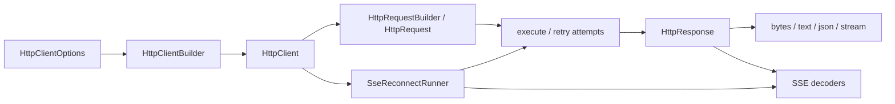

# qubit-http Design

[中文设计文档](design.zh_CN.md) | [User Guide](user_guide.en.md) | [README](../README.md)

This document describes the execution boundaries of `qubit-http` 0.16.0. The source code and tests define the behavior; this document records the choices that callers and maintainers need to preserve.

## Components and ownership

`HttpClientBuilder` validates `HttpClientOptions` and creates the underlying `reqwest::Client`. A client owns the connection pool, default policy, injectors, interceptors, and a redaction snapshot. `HttpRequestBuilder` captures the base URL, origin policy, default headers, injectors, and redaction context into an `HttpRequest`; a send does not borrow mutable client configuration. The executing client supplies the backend, logging options, request/response interceptors, and outer retry policy, while the request's captured redactor is the single policy for request/response logs, execution errors, later response reads, and SSE diagnostics. Executing a request built by client A on client B does not merge or replace A's redaction snapshot. Rebuilding a client does not rebind old requests; callers needing a new redaction policy build a new request from the rebuilt client. Initial URL resolution and origin checks use the request snapshot. Redirect checks use the executing client's reqwest redirect policy and the original request origin. Independently constructed `HttpLogger` values continue to use their explicitly supplied policy.

`HttpClient::rebuild_with_options` constructs a new backend and redaction snapshot while cloning the client's registered header injectors and request/response interceptors. It leaves the original client untouched, including on validation failure. `to_builder` copies options only. Callers that rebuild a configured client must choose the preserving API when runtime hooks are part of their contract.

`HttpClientOptions` owns caller-supplied DER trust roots as `Vec<Bytes>`, with one certificate per entry. The backend keeps its default trust sources and adds these roots; an empty vector adds none. Invalid DER and backend/platform failures surface during client construction. This does not change default certificate or hostname verification. Custom roots are configured programmatically and are not read from configuration files. Targets whose selected TLS backend cannot use custom roots fail construction.

Adding this public field affects downstream exhaustive `HttpClientOptions { ... }` literals: they must specify `extra_root_certificates_der`. Literals using `..HttpClientOptions::default()` need no change.

Use `HttpClient::builder().build()` for defaults, `.options(options).build()` for explicit options, and `HttpClient::from_config(config)` for configuration. The deprecated `HttpClientBuilder::create`, `create_default`, and `create_from_config` methods remain for compatibility; the factory methods ignore options stored on their builder. A request's timeout is initially copied from its creating client's options, while `None` uses the executing backend's default timeout.

The default `SameOrigin` policy checks absolute request targets against a configured base URL and checks each redirect against the initial origin. A client without a base URL may start at an absolute URL, which then defines that request's origin. `AnyOrigin` explicitly relaxes the target and redirect restriction. Configuration readers accept `origin_policy = "same_origin"` or `"any_origin"`; unsupported values fail before client construction.

`AnyOrigin` applies at the request-snapshot stage for initial targets and at the executing-backend stage for redirects. Log redaction and `HeaderValue::set_sensitive(true)` do not filter network headers. A custom API-key header may be forwarded on an allowed cross-origin redirect, while reqwest removes its fixed set of standard authentication headers. Credential-bearing requests should retain `SameOrigin`; cross-origin calls should use a separate request/client without those credentials and validate the destination in application code.

Base URLs are validated at configuration and client construction, and final request URLs are validated after parsing or joining, including after request interceptors. Only HTTP and HTTPS schemes are supported; unsupported request schemes produce `InvalidUrl`. IPv4-only filtering applies to the client's local resolver and literal URL checks; an explicitly configured IPv6 proxy literal is rejected at client construction. Environment proxy selection remains delegated to reqwest, so IPv4-only does not constrain the client-to-proxy connection, including when the environment proxy uses IPv6. SOCKS5 keeps remote DNS (`socks5h`), and HTTP/HTTPS proxies control target resolution and egress, so the proxy-to-target address family is also outside the local IPv4 guarantee.

## Request and retry boundary

`HttpClient::execute` resolves the request's retry options. Each admitted attempt checks cancellation, applies request interceptors, resolves the URL and effective headers, logs the request, sends it, maps non-2xx status to `HttpError`, then applies response interceptors and response logging. All these logs and errors use the request's captured redactor; the executing client's logging options still control whether and how much is logged. Retry decisions see errors from this whole pre-return attempt. A returned `HttpResponse` is outside the ordinary HTTP retry boundary: later body or SSE read failures belong to the caller and retain the same request policy.

`max_attempts` and retry diagnostics count this crate's outer attempts. One reqwest execution may include protocol recovery and redirects without another outer attempt; request interceptors and dynamic header injection run per outer attempt, not per low-level send. Disabling this crate's retry leaves reqwest's safe protocol NACK recovery enabled. `request_timeout` applies to a reqwest execution and its response-body reads, not separately to every underlying wire send. Non-success statuses are mapped before success response interceptors, so `Retry-After` for 429/5xx is read from `HttpError`; response/meta hint methods remain available when metadata is handled separately.

Retry attempts clone the request. Buffered bodies can be replayed; a deferred streaming-body factory can create a fresh body for each outer attempt. Both `stream_body` (even after eager collection) and `streaming_body` are represented as reqwest streaming bodies and cannot be replayed through internal 307/308 redirects; the factory is not called again for such a redirect. Use the final upload URL, or `bytes_body` when the payload fits the application's memory budget. The original request must admit the retry flow; within it, retry eligibility and `Retry-After` preference are recalculated from each interceptor-mutated request. The outer attempt and duration budgets stay fixed. `max_duration` is a continuation budget rather than a hard deadline for an admitted request. The response-header timeout is a cumulative deadline from asynchronous preparation through response headers; the synchronous request interceptor runs before it starts. Connect, response-header, read, and `request_timeout` remain separate controls. `request_timeout` is a reqwest per-attempt network request and response-body deadline; it excludes asynchronous header injection, streaming-body factory preparation, retry waits, and other attempts. `response_header_timeout` covers asynchronous preparation through receipt of response headers. `read_timeout` bounds each normal body read and the complete non-success error-body capture phase; capture expiry returns a `Status` error with its status and partial raw body marked incomplete. The terminal `HttpError` retains retry diagnostics and the full `RetryError<HttpError>` source chain.

`HttpRequestStreamingBody::try_new` and `HttpRequestBuilder::try_streaming_body` let the asynchronous preparation factory return `HttpResult<HttpRequestBodyByteStream>`. Preparation errors retain their kind, message, source, request context, and captured redactor and are returned before `reqwest::RequestBuilder::send` for that attempt. The factory is lazy; it runs per outer attempt. Preparation uses the response-header timeout and cancellation path, while errors emitted after a stream is created keep the existing send-error mapping. Existing infallible factory APIs remain compatible and need no migration. Retry classification, possible factory re-execution, and the 307/308 streaming redirect limitation remain unchanged.

`HttpRequestBuilder` privately tracks whether its request-local `Content-Type` came from a body helper. A later typed helper replaces that inferred value; `bytes_body`, `stream_body`, `streaming_body`, and `try_streaming_body` remove it. A value supplied through `header` or a `headers` map containing `Content-Type` is explicit, even when its bytes equal a generated value, and remains authoritative across body changes. Multipart helpers replace their generated boundary while retaining the existing validation and mismatch errors for explicit values. Removing an inferred request-local value does not alter client defaults or injectors, which may become effective again during normal header merging. The lower-level `HttpRequest::set_body` and `set_streaming_body` setters retain headers and do not infer a media type; callers pair them with `set_header` or `remove_header` when needed.

| Timeout | Bounds |
| --- | --- |
| `connect_timeout` | Connection establishment |
| `response_header_timeout` | Asynchronous preparation through response headers; synchronous request interceptor time is excluded |
| `request_timeout` | Reqwest network execution and response-body reads for one attempt; asynchronous preparation, retry waits, and other attempts are excluded |
| `read_timeout` | Each normal response-body read and complete non-success error-body capture |
| `retry.max_duration` | Continuation budget that can stop later retry admission; it is not a hard total timeout and does not cancel an admitted attempt |

Cancellation is checked before sending and during supported I/O and retry waits. The attempt context routes cancellation ownership so an interceptor's replacement or removal of a token can affect that attempt without incorrectly restoring a stale token on a successful response.

## Response body ownership

`HttpResponse` holds one of three body states: backend response, buffered bytes, or stream taken. `bytes`, `text`, and `json` aggregate within `response_body_size_limit` and cache a successful read. Repeated reads and streams from a buffered response reuse the cache, including after request cancellation because no backend I/O remains. Calling `stream` before buffering transfers the backend body to that stream; later aggregate reads cannot regain it. Cancellation prevents reads that still need backend I/O. A failed read is retained so later reads report the original failure category. The stream path intentionally does not impose the whole-body aggregation limit; SSE line/frame and JSON limits apply to their respective decoders. Applications that must stop business processing immediately on cancellation should check the token at their processing boundary.
Response reading implementations live in the `aggregate`, `streaming`, and `status_capture` type-local modules explicitly declared by `HttpResponse`; the API and semantics are unchanged.

A successful response interceptor may change the headers exposed by `headers()`. Aggregate reads use the original response's parsed `Content-Length` snapshot for early rejection, then enforce `response_body_size_limit` against bytes actually read. Editing or removing the displayed length does not change either body limit.

An aggregate-read future for an unbuffered body takes the backend when first polled. If an outer timeout or losing `select!` branch drops it before buffering succeeds, the backend and partial bytes are lost and later readers report `ResponseBodyAlreadyConsumed`. Dropping an unpolled future does not take the body, and a successful cache remains reusable. This external drop is distinct from cancellation or read timeout returned by the built-in reader, whose failure category is retained.

Non-2xx responses are converted to errors before the caller receives a response. The bounded capture result carries a redacted preview, retained raw prefix, terminal reason, and optional backend error. `HttpBodyCaptureEnd` distinguishes `Complete`, `SizeLimit`, `ReadTimeout`, `ReadFailure`, and `BodyUnavailable`; if raw bytes were already omitted and a later read fails or times out, the final read outcome takes precedence while `is_truncated()` remains true. When the original declared length exceeds both capture limits and both retained prefixes are full, capture may stop with `SizeLimit` without waiting for later network errors; this bounded prefix does not verify complete transport of the declared body. Preview truncation is independent and does not make a complete raw body incomplete. `capture_error()` preserves the URL-stripped backend error and source chain for `ReadFailure`; it is queried through `status_response()` independently of the top-level `HttpError::source()` retry chain and survives snapshot cloning and retry projection. The explicit error getter may expose backend details and must be redacted before logging. `is_truncated()` remains a compatibility boolean that does not distinguish causes. TRACE body logging reports a body only when it has already been buffered; it never consumes an unconsumed backend stream. Request, response, and error diagnostics use the request's captured redaction policy snapshot.

## SSE decoding and reconnect

Direct `HttpResponse::sse_messages` and `sse_chunks` are body decoders. An SSE data event is dispatched only by a blank line; pending data-bearing fields are not dispatched at EOF; complete retry and control-only id records retain their existing handling. A UTF-8 BOM is removed only when it begins the first line. `AllowEof` accepts a complete stream without a done marker but does not dispatch an incomplete final event; `RequireDoneMarker` recognizes a marker only in a complete event. The decoders enforce line/frame and, for JSON chunks, JSON and completion limits, but do not automatically validate `Content-Type`. Callers may invoke the optional, non-consuming `HttpResponse::validate_sse_content_type()` first; it checks only the response media type and does not read the body. `HttpClient::execute_sse_with_reconnect` reuses this check after its 204 early-exit branch. The decoder cooperatively yields during long runs of lines and filtered records so ready input does not monopolize one task poll; its private work budget is not a public timing guarantee. This scheduling yield does not change buffered-body cancellation semantics.

The reconnect runner opens a response with ordinary HTTP retry disabled, decodes SSE records, tracks the last event ID and server `retry:` delay, and reopens according to `SseReconnectOptions`. This API uses the independent `SseReconnectOptions.retry` policy: ordinary HTTP retry settings, method policy, and request-level `disable_retry()` do not disable outer SSE reconnects. The original request may be sent repeatedly, including with `POST` or `PATCH`; callers must ensure the operation and body are safe to repeat under a business-level idempotency guarantee. A factory that creates a fresh body stream provides technical replayability, not business idempotency. Prefer `GET`; use `execute` to manage connections directly when complete replay control is required. Messages without a new ID inherit the latest reconnect cursor, including control-only ID updates and explicit empty-ID resets. Once a server ID exists, the runner's non-empty cursor overrides merged defaults, injectors, interceptors, and request-local headers; an empty ID removes the final header. Before any server ID, ordinary header precedence remains. A valid `retry:` field is emitted as a control record as soon as its line is decoded, without waiting for a blank-line event boundary. When server retry hints are honored, an applied delay remains in effect even if a subsequent body read fails, and persists until another valid `retry:` replaces it. `honor_server_retry = false` ignores server hints. A 204 response ends the reconnect stream normally without a media-type check, body read, or another attempt. These are deliberate behavior changes, not a claim of full EventSource compliance. The original request token controls reconnect waiting and later admission; an interceptor replacement controls only that attempt’s I/O, and removing it does not remove the flow token. Cancellation and protocol errors do not reconnect by default. Reconnect budgets include attempts and waits; a configured final delay cap and the SSE one-millisecond minimum are applied by the reconnect policy.

The decoder commits complete control-only `id:` lines before either normal EOF or a body read failure/timeout, so a reconnect retains the new value on both paths. An empty ID clears the cursor and suppresses `Last-Event-ID`. An ID associated with data is committed only after a blank line dispatches the event; if a read fails first, pending data and its ID are discarded. At normal EOF an unterminated final `id:` fragment is processed by the line decoder, but a fragment cut off by a read error is not yielded as a complete line. IDs containing NUL are ignored. This cursor behavior is the library's recovery contract and does not provide application-level delivery or exactly-once guarantees.

Specification comparison: the WHATWG [HTML Standard, Server-sent events](https://html.spec.whatwg.org/multipage/server-sent-events.html) was checked on 2026-11-11 (page marked “Last Updated 9 November 2026”). Section 9.2.6’s “process the field” rule for `id` sets the last-event-ID buffer unless the value contains NUL; its end-of-file rule discards pending data. In the browser dispatch algorithm, step 1 copies the buffer to the EventSource last-event-ID string; steps 2–3 clear or trim the data buffer as appropriate. Section 9.2.3’s reestablish-connection algorithm, step 3 (substeps 3.1–3.2), sets `Last-Event-ID` when that string is non-empty. The library borrows the field validity and incomplete-data boundary, while its explicit control-record API commits control-only IDs before read errors; it does not claim full EventSource behavior.

The time budgets in `SseReconnectOptions.retry` are admission limits, not hard stream deadlines:

| Phase | Operation time | Total time |
| --- | --- | --- |
| Connection opening and response validation | Counts time spent in completed attempts | Counts elapsed time |
| SSE record consumption, including paused consumer polling | Excluded | Counts elapsed time |
| Reconnect wait | Excluded | Counts elapsed time |

Operation time accumulates time spent in completed connection-opening attempts, not SSE consumption or reconnect waits. Total time includes elapsed consumption and waits; admission limits do not interrupt an active stream. Request timeout, read timeout, and cancellation remain independent controls.

The frame limit counts cumulative UTF-8 bytes of non-empty, non-comment logical lines between blank-line boundaries; see [SSE Decoding](user_guide.en.md#sse-decoding) for the full contract.

For reconnectable 429/5xx handshake failures, the final request's `honor_retry_after` preference controls whether the parsed HTTP hint enters that attempt's reconnect backoff. HTTP `Retry-After` remains a single-attempt hint governed by the configured backoff policy and reconnect budget; `server_retry_max_delay` caps only SSE `retry:` delays. SSE decoder errors inherit missing method, original request URL, and status from the response while retaining existing specific context, redaction, and source.

Request construction keeps raw relative-path input out of URL resolution errors. Explicit proxy URLs are built from a validated domain or IP literal plus the separate configured port, so authority separators and embedded credentials cannot be smuggled through `proxy.host`. Multipart parsing rejects duplicate `boundary` parameters. `stream_body` eagerly collects a finite iterator into memory; use `streaming_body` when a deferred per-attempt stream factory is required.

## Invariants to test when changing this design

- A failure after a response is returned must not trigger ordinary HTTP retry.
- A failed body read must retain its error category on subsequent reads.
- A retry must not reuse an already-consumed one-shot upload stream.
- Cancellation token replacement or removal by an interceptor must remain attempt-scoped.
- Direct SSE decoding and automatic reconnect must keep their distinct media-type contracts.
- Logs and error formatting must use the captured redaction policy and bounded body previews.
- Rebuilding a client must preserve registered hooks without mutating the old client.
- Same-origin redirects must not connect to a cross-origin target; IPv4-only clients also reject IPv6-literal redirect targets as `InvalidUrl`, and the redirect limit must still apply.
