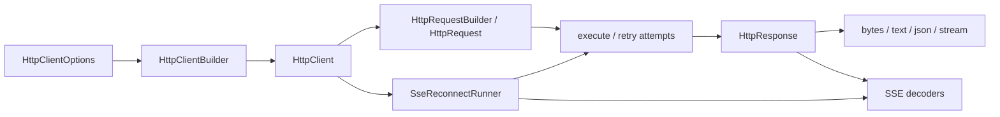

# qubit-http 设计文档

[English Design](design.md) | [用户指南](user_guide.zh_CN.md) | [README](../README.zh_CN.md)

本文记录 `qubit-http` 0.16.0 的执行边界和必须保持的约束。具体行为以源码和测试为准；这里重点说明调用方和维护者容易误解的设计选择。

## 组件与所有权

`HttpClientBuilder` 校验 `HttpClientOptions`，再构造底层 `reqwest::Client`。客户端持有连接池、默认策略、注入器、拦截器和脱敏策略快照。`HttpRequestBuilder` 将 base URL、origin policy、默认请求头、注入器和脱敏上下文捕获到 `HttpRequest`；发送请求时无需借用可变的客户端配置。执行客户端提供后端、日志选项、请求/响应拦截器和外层重试策略；请求捕获的 redactor 则统一用于请求/响应日志、执行错误、返回后的响应读取和 SSE 诊断。客户端 A 构建的请求由客户端 B 执行时，不合并或替换 A 的脱敏快照。客户端重建不会重绑旧请求；需要新脱敏策略的调用方应通过新客户端重新构建请求。独立构造的 `HttpLogger` 仍使用调用方显式指定的策略。初始 URL 解析和来源检查使用请求快照；重定向检查使用执行客户端的 reqwest 重定向策略和原始请求源。

`HttpClient::rebuild_with_options` 构造新的后端和脱敏策略快照，同时复制原客户端注册的请求头注入器、请求拦截器和响应拦截器。包括校验失败在内，原客户端始终不变；`to_builder` 则只复制选项。调用方若依赖运行时注册项，应选择保留它们的重建 API。

默认的 `SameOrigin` 策略会以配置的 base URL 校验绝对请求目标，并以初始源校验每次重定向。未配置 base URL 时，可由绝对请求 URL 确定本次请求的初始源。只有显式选择 `AnyOrigin` 才允许跨源目标及重定向。配置读取器接受 `origin_policy = "same_origin"` 或 `"any_origin"`，不支持的值会在构造客户端前报错。

base URL 在配置解析和客户端构造时校验；最终请求 URL 在解析或 join 后校验，拦截器修改后的目标也会检查。仅支持 HTTP 和 HTTPS；不支持的请求 scheme 返回 `InvalidUrl`。IPv4-only 过滤仅作用于客户端本地 resolver 和 URL literal 检查。SOCKS5 保留远端 DNS（`socks5h`），因此代理解析的目标及代理到目标这一段的地址族不受本地 IPv4 保证约束。

## 请求与重试边界

`HttpClient::execute` 先解析请求的重试选项。每次获准的尝试都会检查取消状态、运行请求拦截器、解析 URL 和最终请求头、记录请求日志、发送请求、将非 2xx 状态映射为 `HttpError`，最后运行响应拦截器并记录响应日志。此处日志与错误均使用请求捕获的 redactor；是否记录及 body 展示限额仍由执行客户端控制。响应返回前这一整段路径产生的错误可参与重试；`HttpResponse` 返回后的 body 或 SSE 读取错误由调用方处理，不进入普通 HTTP 重试，但仍保留相同请求策略。

`max_attempts` 和重试诊断统计本库的外层尝试次数。一次 reqwest 执行可能包含协议恢复和重定向，但不会增加外层计数；请求拦截器和动态请求头注入按外层尝试运行，不会针对底层发送重复运行。关闭本库重试仍保留 reqwest 安全的协议 NACK 恢复。`request_timeout` 限制一次 reqwest 执行及其响应体读取，不会为每次底层网络发送分别计时。非成功状态会在成功响应拦截器前映射为错误，因此 429/5xx 的 `Retry-After` 从 `HttpError` 读取；response/meta 提示方法仍可用于单独处理的 metadata。

每次重试都会克隆请求。缓冲请求体可以重放；延迟生成的流式请求体由工厂为每次外层尝试重新创建。`stream_body`（即使已提前收集到内存）和 `streaming_body` 都会表示为 reqwest 流式 body，无法通过内部 307/308 重定向重放；此类重定向也不会再次调用工厂。优先使用最终上传 URL；载荷符合应用内存预算时可改用 `bytes_body`。原始请求决定是否准入重试流程；流程内则依据拦截器修改后的每次请求重新计算续试资格和 `Retry-After` 偏好。外层尝试次数和时长预算保持固定。`max_duration` 控制是否继续尝试，并非已经开始的请求的硬截止时间；response-header 超时从异步请求准备开始，累计至收到响应头；同步 request interceptor 在期限开始前执行。连接、响应头、读取和 `request_timeout` 仍分别配置。`request_timeout` 是 reqwest 单次网络请求及响应体读取期限，不包含异步 header 注入、流式 body 工厂准备、重试等待及其他尝试；`response_header_timeout` 覆盖异步准备直到收到响应头；`read_timeout` 限制每次正常 body 读取及完整的非成功错误体采集。最终 `HttpError` 保留重试诊断信息和完整的 `RetryError<HttpError>` 错误来源链。

| 超时 | 限制范围 |
| --- | --- |
| `connect_timeout` | 建立连接 |
| `response_header_timeout` | 异步准备直到收到响应头；不包含同步 request interceptor 的耗时 |
| `request_timeout` | 单次尝试中的 reqwest 网络执行和响应体读取；不包含异步准备、重试等待及其他尝试 |
| `read_timeout` | 每次正常响应体读取及完整的非成功错误体采集 |
| `retry.max_duration` | 控制是否准入后续重试的续试预算；不是严格的总超时，也不会取消已准入的尝试 |

取消状态会在发送前、受支持的 I/O 阶段以及重试等待期间检查。尝试上下文负责令牌归属：拦截器替换或移除取消令牌后，该次尝试按新状态执行，成功响应也不会错误地恢复旧令牌。SSE 重连中，原始 token 控制重连等待和后续准入；拦截器替换的独立 token 只控制该次 I/O，移除它不会移除流级 token。

## 响应体所有权

`HttpResponse` 的 body 分为后端响应、已缓冲字节和已移交给流三种状态。`bytes`、`text`、`json` 在 `response_body_size_limit` 内聚合数据，成功后缓存；已缓冲响应可以重复读取，也可以重复创建流，请求取消后也一样，因为此时无需后端 I/O。尚未缓冲时调用 `stream` 会把后端 body 移交给返回的流，后续聚合读取不能再取回；仍需后端 I/O 的读取会被取消阻止。读取失败会被记录，后续读取仍报告原先的错误类别。流式读取不受整包聚合上限约束；SSE 行/帧和 JSON 解码各自使用相应限额。若应用要求取消后立即停止业务处理，应在业务处理边界检查 token。

成功响应拦截器可以修改 `headers()` 展示的响应头。整包读取使用原始响应解析出的 `Content-Length` 快照做提前拒绝，然后仍按实际读取的字节执行 `response_body_size_limit`。修改或移除展示长度不会改变这两项响应体限制。

未缓冲 body 的聚合读取 future 首次被轮询时会接管后端响应。若外层 timeout 或 `select!` 落败分支在缓存完成前丢弃它，后端响应和部分已读字节都会丢失，后续 reader 返回 `ResponseBodyAlreadyConsumed`。丢弃尚未轮询的 future 不会接管 body；成功缓存仍可复用。这个外部 drop 与库内读取器返回的取消或读取超时不同，后者会保留原有错误分类。

非 2xx 响应会在返回调用方前转换为错误。受限采集结果包含脱敏预览、保留的 raw 前缀、最终结束原因和可选 backend 错误。`HttpBodyCaptureEnd` 区分 `Complete`、`SizeLimit`、`ReadTimeout`、`ReadFailure` 和 `BodyUnavailable`；若 raw 已遗漏字节后又发生读取失败或超时，最终记录后发生的读取结果，但 `is_truncated()` 仍为 true。preview 截断与 raw 完整性相互独立，不会令完整 raw body 变为不完整。`capture_error()` 为 `ReadFailure` 保留移除 URL 后的 backend 错误及 source 链；调用方通过 `status_response()` 查询，与顶层 `HttpError::source()` 重试链相互独立，并能经过快照克隆和重试投影保留。显式错误 getter 可能暴露 backend 详情，记录前必须脱敏。`is_truncated()` 保持不区分原因的兼容布尔语义。TRACE 日志只记录已经缓存的 body，不会为了日志消费尚未读取的后端流。请求、响应及错误诊断均使用请求捕获的脱敏策略快照。

## SSE 解码与自动重连

`HttpResponse::sse_messages` 和 `sse_chunks` 是响应体解码器：只有空行才会派发 SSE data 事件，EOF 不派发未完成的数据事件；完整的 retry 与 control-only id 控制记录仍按既有规则处理。仅首行开头的一个 UTF-8 BOM 会被移除。默认 `AllowEof` 允许完整事件流在没有 done marker 时结束，但不派发未完成帧；`RequireDoneMarker` 只接受完整事件中的 marker。解码器执行行/帧限制，以及 JSON chunk 的 JSON 和完成条件限制，但不检查 `Content-Type`。如果上游协议要求 SSE，直接调用者须先校验 `text/event-stream`；`HttpClient::execute_sse_with_reconnect` 会自行校验媒体类型。

重连执行器禁用内层普通 HTTP 重试，打开响应、解码 SSE record、保存最近的事件 ID 和服务端 `retry:` 延迟，然后依照 `SseReconnectOptions` 再次建立连接。该 API 使用独立的 `SseReconnectOptions.retry` 策略；普通 HTTP 重试设置、方法策略和请求级 `disable_retry()` 都不会禁止外层 SSE 重连。原请求可能被重复发送，包括 `POST` 或 `PATCH`；调用方须确保操作和请求体在业务幂等保证下可以安全重复。工厂能生成新的请求体流只代表技术上可重放，并不保证业务幂等。优先使用 `GET`；需要完全控制重放时，可直接通过 `execute` 管理连接。消息未提供新 ID 时继承最近游标，control-only ID 更新和显式空 ID 重置同样生效。服务端提供 ID 后，重连执行器的非空游标会在默认 header、注入器、拦截器和 request-local header 合并后覆盖最终值；空 ID 会删除最终 header。首个服务端 ID 到达前仍遵循普通 header 优先级。有效的 `retry:` 字段在其所在行解码后即产出控制记录，无需等待事件终结空行。启用服务端 retry 提示时，已经应用的延迟不会因后续 body 读取失败而撤销，并持续生效，直到新的有效 `retry:` 将其替换；`honor_server_retry = false` 会忽略服务端提示。204 响应会正常结束重连流，不检查媒体类型、不读取 body，也不再发起连接。这些是有意的行为变化，不代表完整实现 EventSource。取消与协议错误默认不会重连。重连预算覆盖尝试和等待；最终延迟上限及 SSE 的一毫秒最小等待由重连策略处理。

`SseReconnectOptions.retry` 中的时间预算是后续连接的准入限额，并非正在读取流的硬截止时间：

| 阶段 | operation 时间 | total 时间 |
| --- | --- | --- |
| 建立连接及校验响应 | 累计已完成尝试所耗费的时间 | 累计实际经过时间 |
| 读取 SSE record，包括消费者暂停轮询 | 不计入 | 累计实际经过时间 |
| 重连等待 | 不计入 | 累计实际经过时间 |

Operation 时间累计已完成连接建立及响应校验尝试所耗费的时间，不包括 SSE 消费或重连等待。Total 时间包括经过的消费和等待时间；准入限额不会中断正在读取的流。请求超时、读取超时和取消仍按各自规则独立生效。

帧限额统计两个空行边界之间非空、非注释逻辑行的 UTF-8 累计字节数；完整契约见 [SSE 解码](user_guide.zh_CN.md#sse-解码)。

对于可重连的 429/5xx 握手错误，是否把解析出的 HTTP 提示交给本次重连退避策略，由最终请求的 `honor_retry_after` 偏好决定。HTTP `Retry-After` 仍是只作用于单次尝试的提示，遵守独立的退避策略上限和重连预算；`server_retry_max_delay` 只限制 SSE `retry:` 延迟。SSE 解码错误会从响应补齐缺失的 method、原始请求 URL 和 status，同时保留更具体的已有上下文、脱敏规则和 source。

请求构造不会把原始相对路径带入 URL 解析错误。显式代理 URL 由校验后的域名或 IP 字面量和独立配置的 port 结构化生成，避免 `proxy.host` 混入 authority 分隔符或凭据。multipart 解析会拒绝重复 `boundary`。`stream_body` 调用时会把有限迭代器完整收集到内存；需要延迟创建每次尝试的流时使用 `streaming_body`。

## 修改设计时需要验证的不变量

- 响应已返回后发生的错误不能触发普通 HTTP 重试。
- body 首次读取失败后，后续读取仍保留原错误类别。
- 重试不能重复使用已消费的一次性上传流。
- 拦截器替换或移除取消令牌后的状态只属于对应尝试。
- 直接 SSE 解码与自动重连保持各自的媒体类型契约。
- 日志和错误格式化使用捕获的脱敏策略，并限制 body 预览大小。
- 客户端重建后保留运行时注册项，且不修改原客户端。
- 同源重定向不会连接跨源目标；IPv4-only 客户端也会以 `InvalidUrl` 拒绝 IPv6 字面量重定向，同时仍遵守次数上限。
