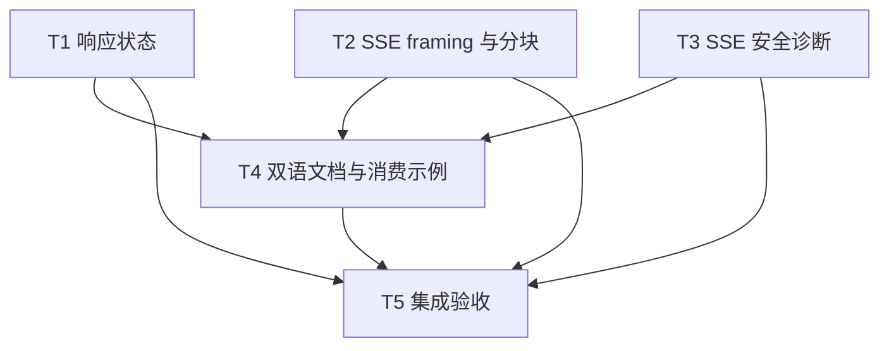

# rs-http 响应状态与 SSE 边界修复实施计划

> **面向智能体执行者：** 使用 executing-plans 逐项实施本计划，使用复选框记录进展。若未来实施明确采用并行执行，可按下表分配互斥写入集合；本计划生成阶段不启动实施。

**目标：** 以最小改动解决 HTTP-001 至 HTTP-007，修正响应体完整性、SSE framing 和诊断，并同步双语文档。

**架构：** 保持现有响应三态和 SSE 分层管线，不新增公共 API、依赖或 feature。局部修正内部状态，确定性测试直达解码层，最终由一个集成任务集中验收。

**技术栈：** Rust 2021、MSRV 1.94、reqwest 0.13、Tokio、futures-util、qubit-budget 0.10、qubit-retry 0.26、qubit-json、qubit-redact。

**项目：** `/data/working/qubit/rust-common/rs-http`。

**设计：** [响应状态与 SSE 边界修复设计](design-20261101T225547187Z-ea0e7a3d.md)。

**文档位置：** 按用户指定直接保存在 doc 目录，没有 Temporary Workspace。后续手动示例类型检查可以使用仓库外临时工程，其可丢弃产物按用户规则清理。

## 采纳范围与持续约束

纳入 HTTP-001（错误体截断）、HTTP-002（EOF 残帧）、HTTP-003（SSE 诊断）、HTTP-004（缓存流状态）、HTTP-005（BOM）、HTTP-006（真实分块测试）、HTTP-007（双语依赖及版本文档）。用户未限定子集，依本次命令纳入全部。明确搁置或拒绝：无。

- 仅修改与当前任务直接相关的内容，不顺手重构、格式化或清理。来源：用户 AGENTS.md。
- CI 只负责验证当前 crate 自身；不得加入或保留 downstream all-features 测试。来源：用户 AGENTS.md。
- 在当前 Paseo workspace 处理目标项目和相关下游，不创建或打开新的 Paseo workspace。来源：用户评审命令。
- 开始时已有 ` M Cargo.lock`，保留原有差异。实施前记录当时基线，防止覆盖或混入用户改动。
- 修改源码、测试或脚本前读取当时适用的用户按需规则。任何 Git 写操作遵循未来实施命令的明确授权并先读 git.mdc；本计划不推断提交、推送或发布授权。

当前方案生成阶段仅写两份文档；后续实施的代码修改、测试及 Git 操作按实施命令判断，不继承已经结束阶段的边界。

## 调度图

表内“可用产物”指已经落地且通过对应 focused check 的内容，不要求预先提交 Git。同批写入集合互斥，具备并行条件；共享默认 target 的 Cargo 命令属于资源组 C，串行执行以避免锁争用。可并行编写不等于必须启动子智能体。

| 任务 | 前置任务 | 最小解锁产物 | 写入集合（项目内相对路径） | 本地验证 | 集成验证归属 | 审查时机 / 批次 |
| --- | --- | --- | --- | --- | --- | --- |
| T1 响应状态 | 无 | 当前公开响应 API | src/response/http_response.rs；tests/response/http_response_tests.rs；tests/client/http_client_error_paths_tests.rs | cargo test --test mod test_status_body_；cargo test --test mod test_cached_stream_ | T5 | 立即审查 / A |
| T2 SSE framing 与分块 | 无 | 当前私有 decode_lines 与公开 SSE API | src/sse/line_decoder.rs；src/sse/frame_decoder.rs；tests/sse/line_decoder_tests.rs；tests/sse/frame_decoder_tests.rs；tests/sse/sse_integration_tests.rs；tests/sse/json_decoder_tests.rs | cargo test --lib sse::line_decoder::tests；cargo test --test mod sse:: | T5 | 立即审查 / A |
| T3 SSE 安全诊断 | 无 | 当前 SseMessage 解码 API | src/sse/sse_message.rs；tests/sse/sse_message_tests.rs | cargo test --test mod sse::sse_message_tests | T5 | 立即审查 / A |
| T4 双语文档与消费示例 | T1、T2、T3 | 三项通过 focused check 的行为与安全诊断契约 | README.md；README.zh_CN.md；doc/user_guide.en.md；doc/user_guide.zh_CN.md；doc/design.md；doc/design.zh_CN.md | 手动临时消费工程 cargo check；文档链接和版本核对 | T5 | 批量审查 / B |
| T5 集成验收 | T1、T2、T3、T4 | 七项变更及 focused 证据 | 仅上列直接相关文件的必要集成修正；报告证据存仓库外 | cargo test；cargo test --doc；项目 CI 检查 | T5 独占重型检查 | 立即审查 / C |

## 任务拓扑依赖图



## 执行准备

- [ ] 在项目目录只读记录 `git status --short`、`git diff --stat` 和已有 Cargo.lock 差异。
- [ ] 检查实际项目指令；修改 Rust 生产代码、文档注释、测试前分别读 `~/.agents/specs/rust-coding.mdc`、`rust-comment.mdc`、`rust-test.mdc`；已确认缺陷实施前读 `bug-fix.mdc`。
- [ ] 比对设计中的符号和当前基线；若代码已修复，核对对应回归后记录已满足，不重复实现。
- [ ] 下列命令均在项目根目录执行；`--test mod` 对应当前 `tests/mod.rs` 聚合目标。若未来 Cargo 显式改了 target 名，以实际清单替换并记录，不另造测试目标。

## T1：修正错误体完整性与缓存响应状态

**条目：** HTTP-001、HTTP-004。

**文件：** `src/response/http_response.rs`、`tests/client/http_client_error_paths_tests.rs`、`tests/response/http_response_tests.rs`。

**输入/输出接口：** 保持 `HttpResponse::stream(&mut self) -> HttpResult<HttpByteStream>`、`bytes(&mut self)`、`HttpStatusResponse::is_truncated()` 和私有 capture 返回三元组的类型不变。向 T4 输出可准确说明的两类截断及 cached stream 契约。

- [ ] 在现有客户端测试中增加失败用例 `test_status_body_preview_truncation_does_not_truncate_raw`。复用 `spawn_one_shot_server` 的 Immediate 响应，429、Content-Type application/json，raw_limit=64、preview_limit=4；断言完整 body、`is_truncated()==false`、原始 JSON 可解析。核心测试为：

```rust
#[tokio_test]
async fn test_status_body_preview_truncation_does_not_truncate_raw() {
    let body = br#"{"error":{"code":"quota_exceeded"}}"#.to_vec();
    let server = spawn_one_shot_server(ResponsePlan::Immediate {
        status: 429,
        headers: vec![("Content-Type".to_owned(), "application/json".to_owned())],
        body: body.clone(),
    }).await;
    let mut options = HttpClientOptions::default();
    options.base_url = Some(server.base_url());
    options.error_response_preview_limit = 4;
    options.error_response_body_limit = 64;
    let client = HttpClientBuilder::new().create(options).unwrap();
    let error = client.execute(client.request(Method::GET, "/quota").build())
        .await.unwrap_err();
    let raw = error.status_response().unwrap();
    assert_eq!(raw.body().as_ref(), body.as_slice());
    assert!(!raw.is_truncated());
    let value: serde_json::Value = serde_json::from_slice(raw.body()).unwrap();
    assert_eq!(value["error"]["code"], "quota_exceeded");
    timeout(Duration::from_secs(3), server.finish()).await.unwrap();
}
```

- [ ] 增加 `test_status_body_` 前缀的矩阵用例：preview/raw 上限互换；body 长度小于、等于和大于 raw 上限；Content-Length 已知以及 chunked 未知且恰好 EOF；读取失败、读取超时和取消。检查预览标记与 raw bool 各自独立，取消维持 Cancelled。未知长度等于 raw_limit 时必须实际读到 EOF 后返回 false。
- [ ] 在响应测试增加 `test_cached_stream_preserves_buffered_body`；导入 `futures_util::StreamExt`。用 `HttpResponse::new` 构造 b"cached"，运行 `bytes → stream → bytes → stream`，两次流均得到相同字节；第二次 bytes 不得报已消费。补充流未读即丢弃、首次 bytes/text/json 已缓存后的组合。
- [ ] 运行表中 T1 两组 focused 命令，确认新测试暴露截断混淆和缓存丢失，而非环境失败。
- [ ] 在 capture 中分别维护 `preview_truncated`、`raw_truncated`。每次 chunk 的剩余空间独立判定，只把预览标志交给 render，把 raw 标志交给返回 bool；保留探测预算、读取失败和取消语义。用读到 EOF 的事实区分“达到上限”与“确实丢数据”。
- [ ] cached stream 分支在 `mem::replace` 之前返回克隆流。实现核心如下，保留原有失败和取消检查位置：

```rust
if let HttpResponseBodyState::Buffered(body) = &self.body {
    let body = body.clone();
    return Ok(Box::pin(futures_stream::once(async move { Ok(body) })));
}
```

- [ ] 重跑 T1 focused 检查，再运行 `cargo test --test mod response::` 和 `cargo test --test mod client::http_client_error_paths_tests`，确认 backend 单次消费、取消与首次错误保持不回退。修正当前函数的英文 Rustdoc，不做响应模块拆分。
- [ ] 审查 T1 diff 与用户已有改动的边界，记录通过的具体测试及退出码。

## T2：修正 SSE EOF、BOM 与真实分块覆盖

**条目：** HTTP-002、HTTP-005、HTTP-006。

**文件：** 调度表列出的两个生产 decoder 和四个相关测试文件；生产测试模块直接置于 `line_decoder.rs` 的 cfg(test) 中，避免为测试新增公共 API。

**输入/输出接口：** `decode_lines(HttpByteStream, usize)` 签名不变，frame decoder 的记录流类型不变。向 T4 输出严格 framing、起始 BOM 和逻辑行限额契约。

- [ ] 将原先“EOF 派发最后一帧”的期望改为不派发，增加 `data: value`、`data: value\n` 和完整空行三种对照。同时在 JSON 测试增加 `test_require_done_marker_rejects_unterminated_done`：输入 b"data: [DONE]"，第一项必须为 SseProtocol，下一项 None；完整 b"data: [DONE]\n\n" 必须得到 Done。CR、LF、CRLF 均覆盖。
- [ ] 在 `line_decoder.rs` 的 cfg(test) 模块中加入确定性真实分块入口。测试模块按项目规则逐个导入 Bytes、StreamExt、decode_lines、HttpByteStream；核心输入方式如下：

```rust
let chunks = vec![
    Ok(Bytes::from_static(b"\xef")),
    Ok(Bytes::from_static(b"\xbb")),
    Ok(Bytes::from_static(b"\xbfdata: first\r")),
    Ok(Bytes::from_static(b"\n\r")),
    Ok(Bytes::from_static(b"\n")),
];
let input: HttpByteStream = Box::pin(futures_util::stream::iter(chunks));
let lines = decode_lines(input, 64).collect::<Vec<_>>().await;
let lines = lines.into_iter().collect::<crate::HttpResult<Vec<_>>>().unwrap();
assert_eq!(lines, vec!["data: first", ""]);
```

- [ ] 增加单块/逐字节/每个二分切点的等价断言；基准包含 UTF-8 字符、CRLF、BOM 和两帧。额外覆盖首行无 BOM、仅 BOM、双 BOM 只去一个、空首行后正文 BOM、data 值中的 BOM、空块和非法 UTF-8。
- [ ] 添加 max_line_bytes 精确边界：无 BOM 的 n 字节行通过，n+1 拒绝；带 BOM 的 n 字节逻辑行通过，n+1 拒绝；非首行不享有 BOM 宽限。首行临时缓冲超额最多三个字节。
- [ ] 运行 `cargo test --lib sse::line_decoder::tests` 和 `cargo test --test mod sse::`，确认回归按预期失败。
- [ ] 删除 frame decoder EOF 分支的 Dispatch 生成，不删除或搬迁文件。保留已有控制记录路径；尤其禁止带未完成 data 的 id 提前成为恢复游标。普通 AllowEof 不改变 framing 完整性要求。
- [ ] 为 line decoder 增加 first-line 状态，首行 append 的上限是 `max_line_bytes.saturating_add(3)`，其余行不变；每个 take-buffer 出口先判定并去掉一个首行 BOM，再按实际逻辑长度执行原有上限检查。取出首行后立即消耗首行状态，即使结果是空行。UTF-8 错误保持原 kind。
- [ ] 将两个现有 join/flatten helper 精确改名为 `buffered_response_from_parts`，局部更新调用点；把声称跨 chunk 的测试改为准确描述缓存内容，把原 trailing flush 期望改为只接受完整帧。不扩大到无关文件的批量重命名。
- [ ] 重跑 T2 focused 检查，覆盖现有 reconnect 测试中的 Last-Event-ID、retry 提示、EOF 重连、取消和预算。若旧用例依赖未完成帧，修改输入为完整帧并保留其原本业务断言；只在确需改动的同模块文件内处理并记录理由。
- [ ] 核查英文 Rustdoc 已说明 BOM 与 EOF framing；审查实现未新增兼容开关和公共导出。

## T3：移除自动 SSE 诊断中的原始元数据

**条目：** HTTP-003。

**文件：** `src/sse/sse_message.rs`、`tests/sse/sse_message_tests.rs`。

**输入/输出接口：** SseMessage 字段、解码方法签名和 source 类型不变。错误消息收敛到固定摘要；DEBUG event/id 字段改为存在性和字节数。

- [ ] 增加严格模式测试：event=`PRIVATE_EVENT_TOKEN`、id=`PRIVATE_CURSOR_TOKEN`、data=`PRIVATE_PAYLOAD_TOKEN`。对 message、Display、Debug、source 的安全格式断言均不含三个值，同时断言 SseDecode 与 JsonDecodeError source 仍在。
- [ ] 用现有 `capture_trace_logs` 增加 Lenient 测试：输入相同三个秘密，结果 None；日志包含 error_kind、error_stage、event_present、event_bytes、last_event_id_present、last_event_id_bytes，且不包含秘密。补充 None 与空字符串情况；保留预算失败不被 Lenient 吞掉的现有断言。
- [ ] 运行 `cargo test --test mod sse::sse_message_tests`，确认旧的明文输出触发失败。
- [ ] `json_decode_error` 使用固定消息并保留原 source：

```rust
HttpError::sse_decode("Failed to decode SSE message data as JSON")
    .with_source(error)
```

- [ ] Lenient tracing 删除 event/id 内容字段，替换为布尔值及 String::len 的结果，不输出内容前缀、编码或散列。改动示意字段：

```rust
event_present = self.event.is_some(),
event_bytes = self.event.as_ref().map_or(0, String::len),
last_event_id_present = self.last_event_id.is_some(),
last_event_id_bytes = self.last_event_id.as_ref().map_or(0, String::len),
```

- [ ] 更新现有“错误消息/日志包含 event/id”的断言，保留数据内容未泄露、JSON 诊断安全和预算 source 的断言；重跑 focused 检查。
- [ ] 审查没有向 SseMessage 添加字段，没有改变其公开数据和 Debug 派生；补充解码诊断的英文 Rustdoc。

## T4：同步双语说明和依赖示例

**条目：** HTTP-007，并记录 HTTP-001 至 HTTP-006 的最终契约。

**文件：** 六份文档见调度表。前置 T1/T2/T3 的行为和 focused 检查均可用；可在此前只读准备文档事实，但最终文案须核对已实现结果。

- [ ] 核对实际 Cargo.toml 版本，当前为 0.16.0；统一指南与现有设计的适用版本。指南直接 budget 版本由 0.9.1 改为 0.10，英文 README 直接 retry 建议由 0.25 改为 0.26。
- [ ] 在中英文对应章节分别写清：raw 与 preview 独立；cached stream 可重复；EOF 丢弃残帧；RequireDoneMarker 只接受完整事件中的 marker；AllowEof 不放宽 framing；起始一个 BOM 被忽略；自动诊断仅有元数据长度和存在性。
- [ ] 写入迁移说明：依赖 EOF flush 的上游须发送终止空行；依赖原错误字符串或日志字段的应用改用 kind 和安全 source；下游错误分类可能恢复 provider_code。只改相关段落，保持术语和两种语言的事实一致。
- [ ] 实施者在仓库外临时工程复制指南的完整依赖表，仅将 qubit-http 一项指向本地源码；直接依赖保留文档声明版本。用以下完整程序类型检查关键调用链：

```rust
use bytes::Bytes;
use http::HeaderMap;
use http::Method;
use http::StatusCode;
use qubit_budget::json::JsonValueLimits;
use qubit_http::HttpResponse;
use url::Url;

fn main() {
    let response = HttpResponse::new(
        StatusCode::OK,
        HeaderMap::new(),
        Bytes::from_static(b"data: [DONE]\n\n"),
        Url::parse("https://example.test/events").unwrap(),
        Method::GET,
    );
    let _response = response.json_value_limits(
        JsonValueLimits::builder().max_nodes(10_000_usize).build(),
    );
}
```

- [ ] 上述临时程序使用构造器所需的补充依赖 `bytes = "1"`、`url = "2"`；这两项只用于验证夹具，不冒充指南原来已声明。临时工程的 qubit-http 声明为 `{ version = "0.16.0", path = "/data/working/qubit/rust-common/rs-http" }`，其余文档依赖保持不变。运行 `cargo check --manifest-path <本次实际临时目录>/Cargo.toml`，记录实际路径和退出码；无需网络 HTTP 请求。不得改项目 Cargo.toml 来让错误文档清单通过。
- [ ] 对两种语言的同一依赖表分别核对，确认改正后的示例类型检查成功；扫描本轮涉及的 0.9.1、0.25、0.15.1 旧说明，保留真实历史叙述而不是全库替换版本字符串。
- [ ] 检查六份文档的相对链接和更新过的锚点，不为此更换版式、目录结构或添加下游 CI。

## T5：最终集成与交付证据

**条目：** HTTP-001 至 HTTP-007。

**前置产物：** T1/T2/T3 focused 检查及 T4 示例检查；本任务独占完整测试、Clippy、Rustdoc、coverage 等重型流程。若出现真正的新回归，修正后只重跑受影响检查，再进行必要的最终门禁。

- [ ] 比对 diff，确认所有变化均可映射到七项；用户已有 Cargo.lock 差异得到保留，未擅自升级依赖或修改下游仓库。
- [ ] 运行 `cargo test`；期望当前 crate 所有测试成功。运行 `cargo test --doc`；期望英文 Rustdoc 示例成功。记录真实输出，不能以评审阶段的临时探针代替回归证据。
- [ ] 检查 `.infra/bin/ci-check.sh` 及实际 bootstrap 工具将执行的步骤；运行前确认验证对象仅当前 crate，不包含 downstream all-features。若工具会执行写入或清理，先核实对象和授权，不能按脚本名推断安全性。
- [ ] 依未来实施授权运行项目要求的格式对齐与检查；先确认不会改动无关文件。若工具修改无关内容，保留用户工作，采用针对本轮文件的替代检查并报告原因。最终执行 `./.infra/bin/ci-check.sh`，其配置已包括 style、clippy、strict-doc、readme、feature matrix、coverage 等任务，避免无理由重复整个矩阵。
- [ ] 不添加新的 downstream all-features 任务。不以未执行的下游测试声称兼容性通过；报告对 OpenAI 分类器和 Chat/Responses SSE 使用的源码核对，以及当前实际依赖仍为 ^0.15 的事实。需要进一步运行下游时，按实施命令实际范围进行独立手工检查，不纳入本 crate CI。
- [ ] 按以下矩阵逐条给出“文件/测试或命令/实际结果”，任何未通过项保留原因，不标记已完成：

| 设计验收项 | 任务 | 必须提供的证据 |
| --- | --- | --- |
| 两类截断独立，已知/未知长度边界正确 | T1 | status_body 测试矩阵，完整 JSON 分类前置条件成立 |
| 缓存可重复，backend 仍单次消费 | T1 | cached_stream 测试与既有 response 回归 |
| EOF 不派发残帧，未完成 done 报错 | T2 | 完整/不完整帧和 completion 策略对照 |
| BOM 跨块、正文 BOM 与行上限 | T2 | 私有解码层真实分块单测 |
| 原 chunk 测试不再虚称分块覆盖 | T2 | helper/用例命名变更及确定性测试输入 |
| 诊断无原始 event/id/data，source 仍可用 | T3 | 严格/Lenient/预算测试结果 |
| 双语依赖、版本、迁移说明一致 | T4 | 六份文档检查及临时消费程序类型检查 |
| 当前 crate 全量检查与改动边界 | T5 | 实际命令、退出码、最终 diff |

- [ ] 交付修改摘要、兼容性变化、运行过的验证、未运行项及原因。提交和推送不作为本计划完成的隐含条件；若未来实施命令明确要求，再依当时授权执行相应流程。

## 计划自检记录

- 设计的七项全部对应任务，未增加被搁置项（本轮无搁置项）。
- 调度表、Mermaid 图和任务列表均为 T1、T2、T3、T4、T5；T1/T2/T3 同批写入互斥，T4 依赖最终行为，T5 集中集成检查。
- 未新增公开接口、依赖、feature、模块拆分或下游迁移任务；EOF 和诊断行为变化已提供迁移方式。
- 当前文档阶段边界与未来实施授权区分明确；没有将“不改代码、不测试、不提交”作为未来实施禁令。
- 文档尚未代表实施完成；所有复选框保持未勾选，后续执行者依据实际结果更新。
