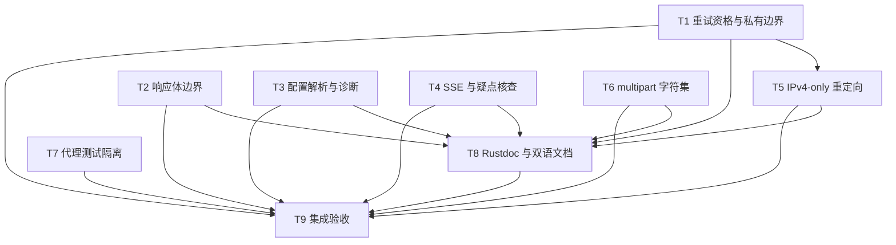

# rs-http 边界修复实施计划

> **面向智能体执行者：** 使用 subagent-driven-development 或 executing-plans，按下面的依赖和文件所有权逐项实施。用复选框跟踪实际结果；不要把本计划的预期输出当作已经通过的证据。执行方式由未来实施任务上下文决定，本阶段不等待用户再次审批方案。

**目标：** 完成本轮 HTTP-R01–HTTP-R11 的局部修复及 HTTP-Q01 的先行核查，保留既有公开 API 和错误来源合同。

**架构：** 在现有执行流程内携带单次尝试的续试资格，修正响应长度/捕获终止、SSE 帧计数/游标和重定向限制。保持 HTTP 重试与 SSE 重连分开；以私有类型传递必要信息，不建立新的通用执行框架。

**技术栈：** Rust 2021、MSRV 1.94、Tokio、reqwest 0.13、qubit-retry 0.26、qubit-budget 0.10。

**设计依据：** [本轮设计](design-20261102T031651234Z-96c18b5f.md)。所有相对路径均相对 `/data/working/qubit/rust-common/rs-http`。本计划按用户指定路径直接落盘，没有创建临时文档工作区或新的 Paseo workspace。

## 1. 范围与持续约束

纳入：HTTP-R01（P1）；HTTP-R02–R08（P2）；HTTP-R09–R11（P3）；HTTP-Q01（P2 核查，未认定缺陷）。没有用户明确搁置、拒绝或排除的条目。不得因没有逐项确认而缩小范围，也不得将 Q01 当成已确认修复任务。

| 纳入条目 | 实施任务 | 处理范围 |
| --- | --- | --- |
| HTTP-R01 | T1 | 拦截后请求的续试资格 |
| HTTP-R02 | T2 | 足量错误体捕获立即结束 |
| HTTP-R03 | T2 | HEAD 正文长度与完整性 |
| HTTP-R04 | T3 | 默认指数退避参数覆盖 |
| HTTP-R05 | T4 | SSE 帧字节计数重置 |
| HTTP-R06 | T4 | 跨重连消息游标继承 |
| HTTP-R07 | T1/T5 | IPv4-only 重定向检查与错误标记 |
| HTTP-R08 | T6 | multipart boundary 合法字符集 |
| HTTP-R09 | T3 | HTTP 配置真实错误路径 |
| HTTP-R10 | T8 | 超时 Rustdoc、诊断与双语说明 |
| HTTP-R11 | T7 | 环境代理测试进程隔离 |
| HTTP-Q01 | T4/T8 | 取消归属核查，按证据决定是否修正 |

持续约束及原始来源：

- 用户 AGENTS.md：「仅修改与当前任务直接相关的内容，不顺手重构、格式化或清理。」
- 用户 AGENTS.md：「CI 只负责验证当前 crate 自身；不得加入或保留 downstream all-features 测试。」
- 用户评审请求：「请在该 workspace 中评审这个目录及相关下游，不要创建或打开新的 Paseo workspace。」本轮后续继续在同一 workspace 处理。
- 用户 AGENTS.md 对重要文件删除、移动、范围外批量操作及按需规则读取的边界继续适用；本计划列出的新建与修改文件均服务本轮条目，不据此授权处理无关文件。

实现选择：不新增公开 API、feature、配置键，不升级依赖或 MSRV，不整体拆分模块，不改下游依赖；确需调整时给出直接相关证据。生产 Rustdoc 使用英文，六份已有双语说明只同步本轮语义。

本计划描述未来实施工作。当前生成阶段不执行下面命令；未来按实际实施授权执行。提交、推送和分支同步不因本计划自动获授权；未来命令若明确要求，按届时授权执行，不将当前阶段边界当成永久禁令。

## 2. 执行准备与基线

- [ ] 在当前 workspace 记录 `git status --short`、`git diff --stat`、当前 HEAD 和相关文件内容。已有 Cargo.lock 修改及两份 20261101T225547187Z-ea0e7a3d 文档均需保留；本轮这两份设计/计划是新增产物。不得用 reset/clean 覆盖原工作。
- [ ] 阅读实际可见的项目 AGENTS.md；修复前读 `~/.agents/specs/bug-fix.mdc`，修改 Rust 生产/注释/测试前组合读取 `rust-coding.mdc`、`rust-comment.mdc`、`rust-test.mdc`。只有触发 Git 写操作或 Shell 脚本/高风险命令时才读对应规则，不遍历规则目录。
- [ ] 重新核对每条静态证据是否仍成立。若已有修复，运行对应回归后记录已满足，不重复改写。
- [ ] 若未来工作流需要 Git worktree，先依据未来授权及 git.mdc 选择基线并读取 using-git-worktrees；dirty 内容不能被隐式丢弃或从 HEAD 漏掉。Git worktree 不等于 Paseo workspace，不创建新的 Paseo workspace。
- [ ] 先检查 `.infra/bin/ci-check.sh`、`.infra/bin/align-ci.sh`、`.infra/bin/project-ci-check.sh` 与实际工具行为，确认验证和可丢弃产物清理范围。不能以脚本名推断可删除对象。
- [ ] 记录运行环境和当前锁定依赖；不自动更新锁文件、下载新工具链或把既有 Cargo.lock 变更归入本轮修复。

## 3. 调度图

写入集合只列本轮会修改的精确路径。所有叶子聚焦 Cargo 命令归资源组 CARGO：同一 target 下串行；代码编辑可以按批次并行。全量门禁只有 T9 运行。最小解锁产物指文件及聚焦检查可用，不隐含 git commit 要求。

| 任务 | 前置任务 | 最小解锁产物 | 写入集合 | 本地验证（在根目录） | 集成验证归属 | 审查时机/批次 |
| --- | --- | --- | --- | --- | --- | --- |
| T1 重试资格和私有边界 | 无 | 私有失败封装、IPv6 marker 已声明；R01 聚焦通过 | `src/client/http_client.rs`、`src/client/internal/http_retry_rule.rs`、`src/client/internal/http_attempt_failure.rs`（新）、`src/client/internal/redirect_ipv6_violation.rs`（新）、`src/client/internal/mod.rs`、`src/client/mod.rs`、`tests/client/http_client_retry_override_tests.rs` | `cargo test --test mod client::http_client_retry_override_tests`；`cargo test --lib client::http_client::tests` | T9 | 立即审查/A |
| T2 响应体边界 | 无 | HEAD 与足量 capture 合同通过 | `src/response/http_response.rs`、`tests/client/http_client_error_paths_tests.rs`、`tests/response/http_response_tests.rs` | `cargo test --test mod client::http_client_error_paths_tests`；`cargo test --test mod response::http_response_tests` | T9 | 立即审查/A |
| T3 配置解析与诊断 | 无 | 默认覆盖与精确错误路径通过 | `src/options/http_retry_options.rs`、`tests/options/http_retry_options_tests.rs`、`tests/options/http_client_options_tests.rs` | `cargo test --test mod options::http_retry_options_tests`；`cargo test --test mod options::http_client_options_tests` | T9 | 批量审查/A |
| T4 SSE 帧、游标及疑点核查 | 无 | R05/R06 回归通过；Q01 有分支结论 | `src/sse/frame_decoder.rs`、`src/sse/sse_reconnect_runner.rs`、`src/sse/sse_reconnect_runner/internal/reconnect_runtime.rs`、`src/sse/sse_reconnect_runner/internal/reconnect_state.rs`（后两项仅经 Q01 证实需要时）、`tests/sse/frame_decoder_tests.rs`、`tests/sse/sse_reconnect_runner_tests.rs` | `cargo test --test mod sse::frame_decoder_tests`；`cargo test --test mod sse::sse_reconnect_runner_tests` | T9 | 立即审查/A |
| T5 IPv4-only 重定向 | T1 | T1 导出的私有 RedirectIpv6Violation marker | `src/client/http_client_builder.rs`、`src/error/backend_error_mapper.rs`、`tests/client/http_client_factory_ipv4_only_tests.rs`、`tests/error/backend_error_mapper_tests.rs` | `cargo test --test mod client::http_client_factory_ipv4_only_tests`；`cargo test --test mod error::backend_error_mapper_tests` | T9 | 立即审查/B |
| T6 multipart 字符集 | 无 | 边界验证和已有 Content-Type 校验通过 | `src/content_type.rs`、`src/request/http_request_builder.rs`、`tests/request/http_request_builder_tests.rs` | `cargo test --test mod request::http_request_builder_tests` | T9 | 批量审查/A |
| T7 代理测试隔离 | 无 | 父进程不改环境，子进程双场景通过 | `tests/client/http_client_factory_proxy_tests.rs` | `cargo test --test mod client::http_client_factory_proxy_tests` | T9 | 批量审查/A |
| T8 Rustdoc 与双语文档 | T1,T2,T3,T4,T5,T6 | 已验证行为、Q01 结论与迁移点 | `src/request/http_request.rs`、`src/request/http_request_builder.rs`、`src/options/http_timeout_options.rs`、`README.md`、`README.zh_CN.md`、`doc/user_guide.en.md`、`doc/user_guide.zh_CN.md`、`doc/design.md`、`doc/design.zh_CN.md` | 静态逐段核对六份文档和超时 Rustdoc；相关本地链接核对；编译/测试归 T9 | T9 | 批量审查/C |
| T9 集成验收 | T1,T2,T3,T4,T5,T6,T7,T8 | 全部叶子证据与最终 diff | 仅前述集合内必要集成修正；本轮两份方案文档可更新实际进度 | `cargo test`、`cargo test --doc`、项目当前 crate CI 门禁 | T9 独占 | 立即审查/D |

## 4. 任务拓扑依赖图



T1/T2/T3/T4/T6/T7 是同批互斥写入任务；T5 等待 T1 只因私有 marker 和聚合声明的真实文件依赖。T8 等待 T6 后才编辑同一个 builder 文件。任务不得自行越过写入集合；必要共享文件调整先移交所有权，不能并行覆盖。

## 5. T1：按最终请求收紧续试资格（HTTP-R01）

**接口：** 输入 `HttpRequest` 和 `HttpAttemptExecutionContext`；内部尝试输出 `Result<HttpAttemptResponse, HttpAttemptFailure>`；公开 `HttpClient::execute` 仍输出 `HttpResult<HttpResponse>`。给 T5 输出可导入的私有 `RedirectIpv6Violation`。所有新 helper 完整英文 Rustdoc，类型独立文件。

- [ ] 在现有 retry override 测试添加下表回归，使用本地响应，不访问互联网。用拦截器 AtomicUsize 计数并捕获服务端 method，以证明不是仅修改了错误文本。非续试场景用 one-shot server，测试结束后核对计数为 1；可续试场景用两次响应的 multi-shot server。

| 输入/拦截器 | 返回序列 | 预期 |
| --- | --- | --- |
| enabled + IdempotentOnly；GET→POST | 首次 503 | Status、method POST；拦截器/物理发送均一次 |
| enabled GET；force_disable | 首次 503 | Status；无第二次尝试 |
| enabled GET；POST + AllMethods | 503→200 | 两次 POST、两次拦截器 |
| enabled GET 不修改 | 503→200 | 保留原重试成功行为 |
| 原 POST 不准入，拦截器改 GET | 首次 503 | 保守准入语义：仍一次 |
| interceptor 修改method后返回可重试错误 | Transport | 按最终方法资格终止，不能绕过方法策略 |

可直接使用的关键断言片段（嵌入已建立 server/client 的完整测试）：

```rust
client.add_request_interceptor(HttpRequestInterceptor::new(|request| {
    request.set_method(Method::POST);
    Ok(())
}));
let error = client.execute(client.request(Method::GET, "/method-policy").build())
    .await.expect_err("POST must not be retried by IdempotentOnly");
assert_eq!(error.kind, HttpErrorKind::Status);
assert_eq!(error.method, Some(Method::POST));
assert_eq!(server.finish().await.method, "POST");
```

- [ ] 先运行 T1 聚焦命令，确认失败来自错误的重试次数/方法，而不是端口、断开或测试入口未发现。
- [ ] 在新文件定义私有失败封装，提供 `new(error, retry_allowed, honor_retry_after)` 与 `into_error(self) -> HttpError`，数据形状如下；字段不得扩散到公开 HttpError：

```rust
pub(in crate::client) struct HttpAttemptFailure {
    pub(in crate::client) error: HttpError,
    pub(in crate::client) retry_allowed: bool,
    pub(in crate::client) honor_retry_after: bool,
}
```

- [ ] 单次尝试在 interceptor.apply 返回后立即计算最终资格；即使 apply 是 Err，也使用当时 request 的快照封装错误。代码结构为先保存 `let intercepted = self.request_interceptors.apply(&mut request);`，再计算 `let effective_retry = self.options.retry.resolve(&request); let retry_allowed = effective_retry.should_retry(&request);` 和最终 honor 标志，再对 intercepted 和后续异步失败统一映射。取消前置失败使用当时 request 快照。不要把相同拦截器在一轮执行两次。
- [ ] `HttpRetryRule` 改用 `RetryRule<HttpAttemptFailure>`；`AttemptFailure::Error(failure)` 先判断 `!failure.retry_allowed` 返回 Abort，再按 `failure.error` 检查固定白名单；仅 `failure.honor_retry_after` 为真时发 hint。其他 AttemptFailure 变体保留原 UseDefault。外层 budget/backoff 不因拦截器修改被重建。
- [ ] 终态转换使用 `let error = error.map_error(HttpAttemptFailure::into_error);`，随后沿用 `map_retry_error(...).with_source(error)`；直接路径用 `.map_err(HttpAttemptFailure::into_error)`。新增的 Error/Debug/Display 实现如执行器约束要求，必须仅委托安全 HttpError，不能输出原始请求或 token。
- [ ] 定义供 T5 使用的私有 marker：`struct RedirectIpv6Violation;`，固定 Display 文本 `redirect target is IPv6 while ipv4_only=true`，实现 std::error::Error，声明到 `client/internal/mod.rs` 并按现有 OriginViolation 可见性导出到 client。此步只建立标记，不安装重定向行为。
- [ ] 复跑 T1 聚焦和 inline mapping 测试，精确断言终态 source 可 downcast 为 `RetryError<HttpError>`，保留 body、redactor、原始 source、retry diagnostics。复核成功响应 token 替换/移除测试仍有效。T1 完成后交付 marker 给 T5。

## 6. T2：正文 capture 与 HEAD（HTTP-R02/R03）

**接口：** `HttpResponse::bytes/text/stream` 与 `read_error_body_preview -> HttpResult<(String, Bytes, bool)>` 不变，bool 仍仅表示原始 body 不完整。

- [ ] 在 error_paths 添加已知/未知长度、preview/raw 两种大小关系的捕获测试。最小停顿例用 `preview=4, raw=4`，服务端先发送 `abcde` 再保持连接。可在该测试文件内使用局部 TcpListener 和 oneshot 释放信号，headers 为 chunked/text/plain，精确写出 `5\r\nabcde\r\n`，释放前不发送终止块；测试用 1 秒外层 timeout 对比客户端 30 秒 read_timeout，不用毫秒级性能断言。失败也要释放/回收服务器任务。
- [ ] 断言 Status、raw 等于 `abcd`、raw 截断、预览不是 read-timeout/unavailable。另以普通完成响应验证长度恰为 raw_limit 且真实 EOF 时不截断，以不够捕获量的停顿验证原 ReadTimeout 预览路径仍存在。
- [ ] 添加 HEAD 200、大 Content-Length、实际空 body 的公开 client 回归，断言 headers 保留该长度，而 bytes 为空、text 为空；HEAD 404 断言 status_response raw 为空且 is_truncated=false。普通 GET 相同头值仍应 ResponseBodyTooLarge。测试可使用已有 ResponsePlan::Immediate 并显式提供 Content-Length、body Vec::new()。
- [ ] 先运行 T2 两组命令确认新测试暴露原问题。
- [ ] 每次追加后用 `capture_budget.used() == capture_limit` 判断预算耗尽，结合已确定截断状态立即 break；原有 `captured < chunk.len()` 超出条件仍保留。采用 saturating 上限，保留两个独立标志和未够量时的错误/取消路径。
- [ ] 在 content_length_hint 的开头加入下面分支（若使用 fully qualified Method 应改成顶部单对象 import），不修改对外 headers：

```rust
if self.meta.method() == Method::HEAD {
    return Some(0);
}
```

- [ ] 复跑 T2 两组命令，核对 cached stream、已消费 body、首次读取失败保留及原有截断独立性没有回退。

## 7. T3：默认退避覆盖与真实配置路径（HTTP-R04/R09）

**接口：** `HttpRetryOptions::from_config`、`HttpConfigError` 和 config key 名保持不变；错误 path 改为准确 HTTP schema 字段。

- [ ] 添加不设置 delay_strategy/jitter 的指数参数单独覆盖测试：initial=40ms、max=1s、multiplier=3.0，各自与显式 `delay_strategy=exponential` 的结果比较；完全空配置与 Default 一致。非法 multiplier=0.5 必须失败。
- [ ] 测试可使用以下完整核心流程，新增所需单对象 imports；对策略对象按现有测试的 getter/PartialEq 方式比较，不假定新 API：

```rust
let mut config = Config::new();
config.set("http.retry.backoff_multiplier", 0.5_f64).unwrap();
let section = config.section("http.retry").unwrap();
let error = HttpRetryOptions::from_config(&section).unwrap_err();
assert_eq!(error.kind, HttpConfigErrorKind::InvalidValue);
assert_eq!(error.path, "http.retry.backoff_multiplier");
```

- [ ] 将原 starts_with 测试升级为精确路径矩阵：multiplier、jitter、random_min>max、exponential_initial>max。使用 `client.retry` scope，期望依次为 `client.retry.backoff_multiplier`、`client.retry.jitter_factor`、`client.retry.random_max_delay`、`client.retry.backoff_max_delay`；跨字段错误消息须含两个 HTTP 字段名。
- [ ] 运行 T3 两组命令确认原实现失败。
- [ ] 去掉 from_config 的两字段触发条件，始终构造选定策略。构造点使用如 `HttpConfigError::invalid_value("backoff_multiplier", error.message())` 的 HTTP 字段映射；指数构造失败根据明确的倍率或初始/最大关系选字段，不能盲目把所有指数错误归到 multiplier。random/jitter 各用设计中的键，未知策略保留 delay_strategy。
- [ ] 复跑 T3，保证固定/随机/立即策略、scope、空配置默认值、未知字段拒绝和非法值校验符合原合同。将“以前忽略的配置现在生效/报错”迁移点交给 T8。

## 8. T4：SSE 帧、游标与取消刻画（HTTP-R05/R06/Q01）

**接口：** frame decoder 的 RecordStream 与 runner 的 SseMessageStream 不变。新增回归通过已有公开 response/reconnect API 观察，不扩大可见性、不添加公开测试 hook。

- [ ] R05 回归：max_frame=8，输入 `x: 123\n\nx: 123\n\ndata: a\n\n`，应只得到 data=a，不报 SseProtocol。另测连续含 NUL id 的无效帧、空帧、同一帧真实超限，最后一项仍必须失败。
- [ ] 将空行分支的 `current_frame_bytes = 0;` 移出 has_fields 条件，使每个空行均重置；原 has_fields 内容、控制记录和事件派发不变。先失败后修正运行 frame_decoder 聚焦命令。
- [ ] R06 在现有跨连接游标场景增加第二条消息 `last_event_id == Some("evt-1")`。扩展第三次连接仍无新 id、control-only id 更新、显式空 id 重置三类断言，检查重连请求头和消息游标一致。
- [ ] 在 runner 派发分支使用以下局部算法，并运行 reconnect 聚焦命令：

```rust
Ok(SseRecord::Dispatch(mut message)) => {
    if let Some(id) = message.last_event_id.clone() {
        last_event_id = Some(id);
    } else {
        message.last_event_id = last_event_id.clone();
    }
    yield Ok(message);
}
```

- [ ] Q01 **先核查**：阅读普通 HTTP 的 HttpAttemptExecutionContext、SSE runtime、取消文档和现有测试，记录流级 A 与拦截后 I/O B 的来源。用 interceptor 执行通知、服务端 response-started/释放通道和 tokio time 控制定位取消阶段；不根据“旧 A 仍取消等待”单点判缺陷。
- [ ] 增加刻画矩阵：未变更取消 A；替换 B 后取消 B；替换 B 后取消 A；移除 A 后取消 A。每类检查当前响应读取、EOF 后等待和后续准入中哪些阶段取消、是否错误建立新连接。不要把当前 I/O 的 B 自动永久写回模板，或者让移除 token 隐式移除调用级预算/取消控制。
- [ ] 若符合流级/尝试级合同：记录疑点排除，不改 runtime/state，只保留有意义的行为测试并交 T8 说明。若证明 B 被忽略或 Cancelled 被重连等明确缺陷：先失败测试，再在表中允许的 runner/runtime/state 文件内最小修正，保持公开 API；复跑两组 T4 命令。没有证据支持改变 A 的流级归属时，选择保留并文档化，不擅自扩大修复。
- [ ] 输出 Q01 实际结论、依据、矩阵结果；未运行的场景不得写为通过。复核内层 HTTP retry 仍禁用、done-marker/EOF/BOM 合同未改变。

## 9. T5：重定向目标的 IPv4-only（HTTP-R07）

**前置：** T1 的私有 RedirectIpv6Violation 已可导入；不重新编辑聚合模块，避免所有权冲突。

**接口：** builder.create 与 HttpErrorKind 不变，IPv6 重定向错误使用已有 InvalidUrl；OriginPolicy 违规仍保持该 kind。

- [ ] 添加 IPv4 本地服务返回 302 Location 到 `http://[::1]:<port>/` 的用例：AnyOrigin+ipv4_only=true，断言 InvalidUrl 并检查 source 含 marker，防止 IPv6 不可用环境产生 Transport 假通过。
- [ ] IPv6 loopback 可绑定时加第二监听器，确认 target 没收到连接；不能绑定时只跳过该附加网络断言，核心 InvalidUrl/source 断言仍必须运行，记录环境原因。
- [ ] 同时覆盖 IPv4-mapped IPv6、IPv4→IPv4 允许、SameOrigin 跨源仍拒绝、redirect loop 仍受 max_redirects 限制、ipv4_only=false 不被新 marker 拒绝。若 IPv6 不可用，不要求最后一项实际建立 IPv6 连接。
- [ ] 先执行 T5 聚焦命令，确认原错误是 Transport/连接尝试而不是预期 InvalidUrl。
- [ ] builder 将所有 origin policy 分支统一为一个组合 redirect closure：先同源限制，再 `ipv4_only && matches!(attempt.url().host(), Some(Host::Ipv6(_)))` 返回 marker error，最后 `redirect_policy.redirect(attempt)`。使用 url::Host 的顶部 import，不按字符串冒号判断 IPv6。
- [ ] backend mapper 遍历 source 识别私有 marker，映射 InvalidUrl；安全固定消息不嵌入原始 Location。保持原 OriginPolicy 检测优先级与 timeout 分类。新增测试断言重定向被拒绝不属于 Transport 默认重试类别。
- [ ] 复跑 T5；将具体错误分类和迁移要求交 T8，不改变 per-request ipv4_only 的既有 URL 校验覆盖语义。

## 10. T6：multipart boundary 合法子集（HTTP-R08）

**接口：** `multipart_body(body: impl Into<Bytes>, boundary: &str) -> HttpResult<Self>` 不变；仍不支持任意 quoted boundary。

- [ ] 在 builder 测试用循环覆盖 HTTP token 独有字符的拒绝：`!#$%&*^`、反引号、`|~`。对 `boundary="bad!boundary"` 的无 Content-Type、匹配已有 Content-Type 两种输入均必须失败。保留 mismatch、引号、超长、空值和非 ASCII 测试。
- [ ] 接受集用 `Az09'+_-.`，测试长度 1、70 通过、71 拒绝；确认生成 Content-Type 与 body boundary 一致。先运行 T6 命令确认新拒绝用例暴露原实现。
- [ ] validator 改为以下单字节集合，保留原长度条件：

```rust
matches!(byte, b'0'..=b'9' | b'A'..=b'Z' | b'a'..=b'z'
    | b'\'' | b'+' | b'_' | b'-' | b'.')
```

- [ ] 更新 content_type helper 与 multipart builder 的英文 Rustdoc、错误信息，写清 MIME 与未引用参数安全子集；不改调用方 body 或自动引号策略。
- [ ] 复跑 T6，交付允许字符集合及迁移要求给 T8，T8 此后才编辑同一 builder 的超时文档。

## 11. T7：环境代理测试子进程隔离（HTTP-R11）

**接口：** 仅现有测试文件增加 worker 和父测试 helper；生产代理默认值及测试模块入口不变，不新建测试 binary。

- [ ] 替换原全局 set_var/remove_var 测试为父测试+专用 worker。worker 名固定 `test_env_proxy_worker`，以 `RS_HTTP_PROXY_WORKER` 的 `direct`/`proxy` 值选择场景；无哨兵直接返回。
- [ ] 父测试获取 `std::env::current_exe()`，以参数 `--exact client::http_client_factory_proxy_tests::test_env_proxy_worker --nocapture` 启动；worker 不派生子进程。先在实施环境确认 libtest 完整路径，如果入口变化按真实名字更新，不允许静默运行零个测试。
- [ ] 每个 child Command 的 env_remove 集合明确为 HTTP_PROXY/http_proxy、HTTPS_PROXY/https_proxy、ALL_PROXY/all_proxy、NO_PROXY/no_proxy、REQUEST_METHOD；随后只在 child 设置需要的受控值和哨兵。不使用父进程环境写入 API，不清空其他环境。
- [ ] 父测试启动本地 backend 和可转发 proxy，取得端口后通过 child Command 环境设置 HTTP_PROXY/HTTPS_PROXY，以及 `RS_HTTP_BACKEND_URL`。worker 只读取环境创建客户端，不调用 set_var/remove_var；父测试保持 Tokio runtime 运行以服务请求，不同步阻塞 runtime 线程等待 child。这样两端都不在运行中的多线程进程内修改环境。
- [ ] direct 场景 `use_env_proxy=false`，backend 收到请求且 proxy 未收到；proxy 场景 `use_env_proxy=true`，proxy 收到并转发，backend 返回正常响应。用 captured target/headers 证明经过路径，不能仅断言200。
- [ ] 使用已有 dev-dependency Tokio full 的 `tokio::process::Command`（无需新 feature）设置 child 总超时。stdout/stderr 设为 piped，取出句柄由两个异步读取任务持续排空；对 `child.wait()` 加 30 秒 timeout，超时则 `child.kill().await` 后 `child.wait().await` 回收；最后汇总两个读取任务输出。设置 kill_on_drop 防止父测试提前失败遗留 child；检查退出码和输出中的专用成功标记，不能只因退出码0就接受零测试。worker 成功时输出固定标记 `RS_HTTP_PROXY_WORKER_OK`，不打印代理凭据。
- [ ] direct 场景用测试文件内的局部代理监听任务记录是否有 accept，并由 shutdown oneshot 收尾；proxy 场景复用 ForwardHttp helper 并等待 finish。不可在 direct 场景等待永远不会收到请求的 proxy.finish，也不可遗留未释放监听器。只关闭本测试创建的网络任务和 child。
- [ ] 运行 T7 聚焦。记录父进程相关 env 的调用前后值相同；源码核对父测试无 set_var/remove_var。并行失败此前未复现，不把测试改动描述成已证明解决某次 CI 故障。

## 12. T8：统一超时合同与六份双语说明（HTTP-R10，其他条目文档）

**前置：** T1–T6 已稳定，Q01 有核查结果。T7 的隔离细节主要留测试，不向产品文档泄漏实现流程。

- [ ] 将 request.rs、builder.rs、timeout options 的 response_header_timeout Rustdoc 写清：异步准备开始到收到响应头的累计期限；包括 header injector、streaming factory、网络发送和等待响应头，不包括之前同步执行的 request interceptor。分别解释 read、connect、request timeout，不能再叫独立 write timeout。
- [ ] 仅替换相关诊断中的 `Write timeout`：准备阶段说明 preparing request/streaming request body，send阶段说明 waiting for response headers；kind 仍 ResponseHeaderTimeout，日志脱敏策略不变。查找并同步直接匹配该旧文案的相关测试；若需修改调度表外测试文件，先登记为 T8 必要写入扩展并确认无并发 owner，不能全库替换字符串。
- [ ] 同步中英文 README 的 retry 时间段、两份指南的超时表/重试/配置/multipart/SSE 部分，以及两份设计中的不变量；内容必须基于已验证行为，历史版本事实不做全局版本替换。
- [ ] 明确迁移点：R01 最终方法/覆盖影响续试；R04 旧参数现在生效并校验；R07 IPv6 redirect 被 InvalidUrl 拒绝；R08 要同时替换 body/header boundary；R09 按真实字段定位；Q01 按核查结论文档化两层归属。
- [ ] 静态核对所有代码符号、依赖版本、相对链接与锚点。README 保留已有六徽章与尾部章节，双语内容含义一致，不重写全文、不新增无关示例。
- [ ] 编译与运行示例归 T9；T8 不运行整仓 cargo doc/test/coverage。记录修改段落及映射条目供集成审查。

## 13. T9：集成验收与证据交付

**接口：** 聚合所有任务的实际 diff、聚焦结果与 Q01 结论，维护以下验收矩阵。只由本任务运行重型门禁。

- [ ] 审查各任务改动范围、公开签名及 source 合同；确认没有包含用户已有 Cargo.lock 差异、历史文档改写、下游依赖升级或无关风格重排。
- [ ] 检查必要 formatter/alignment 的实际修改范围。按未来授权及项目流程运行；全仓脚本若会写无关源码，先采用针对本轮文件的格式化方式并说明原因，不覆盖原改动。格式化后检查 `git diff --check` 和最终 diff。
- [ ] 运行 `cargo test`，期望当前 crate 测试通过，父代理测试确实派生并执行 worker；运行 `cargo test --doc`，期望 Rustdoc 示例通过。记录真实退出码；任何失败先定位与本轮关系再修复，不反复盲跑全量。
- [ ] 依据已检查的脚本运行 `./.infra/bin/ci-check.sh`，仅当前 crate。当前配置含 style、clippy、coverage-cfg-clippy、verify、strict-doc、readme、release-build、feature-matrix、project-hook、package、coverage、audit；若该工具已运行等价测试，不无理由重复。若脚本版本要求不同，以实际证据记录。CI 不加入 downstream all-features。
- [ ] 对 CI 未覆盖且本轮确有必要的 Markdown 示例，在仓库外可丢弃消费夹具检查公开 API；指向本地 qubit-http，其余依赖使用文档声明版本。只有实际运行成功才称示例可编译，不能用源码浏览替代；不修改仓库清单来掩盖文档错误。
- [ ] 下游仅按实际授权作源码或独立手工集成核查。说明 llmsdk 仍声明 ^0.15；没有实际绑定本地0.16就不得宣称下游通过。若未来明确授权下游升级，另记录实际绑定版本与验证范围，不加入本 crate CI。
- [ ] 完成下面逐条证据，任何未通过/未验证均明确原因；Q01 只能写“排除”“证实并修正”或具体未完成状态，不能因纳入方案直接标缺陷。

| 设计必须项 | 任务 | 验收证据 |
| --- | --- | --- |
| R01 最终 method/disable/hint 参与续试资格 | T1 | GET→POST和disable只一次；允许POST两次；每轮仅一次interceptor |
| R01 对外 source 和取消所有权保持 | T1/T9 | RetryError<HttpError> downcast、诊断/原source/脱敏、既有token测试 |
| R02 足量 capture 立即完成 | T2 | cap+1后保持连接仍返回有效preview/raw；不足量超时仍存在 |
| R03 HEAD 正文长度 | T2 | 200空body、404完整空raw、头值保留、GET保护保留 |
| R04 单参数与默认值 | T3 | 无strategy覆盖生效、非法值失败、空配置等价Default |
| R05 每帧计数重置 | T4 | unknown-only/invalid-id/空帧对照、真实同帧超限 |
| R06 游标跨连接及重置 | T4 | 多次重连继承、control-only更新、空id不复活旧值 |
| R07 IPv4-only redirect | T5 | InvalidUrl/source marker、目标未连接、origin/limit仍生效 |
| R08 MIME未引用安全字符集 | T6 | 所有独有非法字符拒绝、允许集合/长度/现有header一致性 |
| R09 配置真实路径 | T3 | multiplier/jitter/random/exponential精确path和跨字段消息 |
| R10 超时语义与双语文档 | T8/T9 | Rustdoc/诊断/六文档一致、链接及可运行示例核对 |
| R11 进程环境隔离 | T7 | 父env不变、child确实运行、直连/代理路径与超时回收 |
| Q01 先核查再决定 | T4/T8 | 原A/替换B/移除的阶段矩阵、证据和最终分支结论 |
| 当前crate完整门禁及范围 | T9 | 真实命令/退出码/最终diff；下游验证边界如实报告 |

- [ ] 如未来实施命令授权提交/推送，读取 git.mdc 后只操作本轮授权文件，遵守当时的分支/远端约束；没有该授权时以代码、验证和交付报告完成实施工作，不自动执行 git add/commit/push。

## 14. 计划自检记录

- 调度表、拓扑图、正文任务 ID 均为 T1–T9；无孤立遗漏。T1/T2/T3/T4/T6/T7 同批，T5 有真实接口依赖，T8 的共享文件冲突已通过依赖消除。
- 全部 R01–R11 和 Q01 在范围表、任务及验收矩阵均有对应；无用户排除项，没有遗漏疑点核查。
- 所有叶子任务有精确文件、测试输入与断言、聚焦命令和交付合同；重型验证由 T9 独占，Cargo 共享缓存资源串行。
- 不预设疑点为缺陷；不改变公开签名、不升级依赖、不扩大统一风格整理；破坏行为兼容的边界和迁移方式已在设计列出。
- 当前方案生成边界未写成未来不改代码、不测试、不提交的验收要求；未来版本控制按未来实际授权执行。
- 本阶段只进行了文档内容自检，所有实施复选框仍未勾选，不声称已运行任何实施命令。
